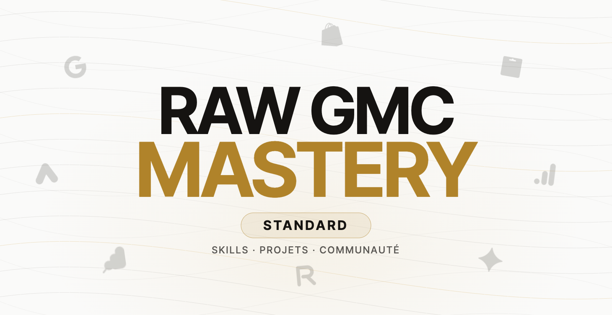

<!-- branding -->

<!-- /branding -->

# RAW GMC Mastery · Communauté Standard

L'espace public des ressources et projets communautaires de RAW GMC Mastery.

## Commencer

Rejoins la formation et la communauté sur [Skool](https://www.skool.com/rawgmcmastery/about).

Cet espace accueillera les ressources gratuites sélectionnées par l'équipe. Aucun téléchargement n'est encore annoncé comme disponible.

## Participer

Utilise Discussions pour les questions sur les ressources, les idées et le partage de projets. Utilise Issues pour signaler un problème précis sur un fichier ou un outil. Les propositions de modification passent par une pull request et la relecture de l'équipe.

Respect, entraide, pas de spam ni de démarchage. Ne publie pas de mots de passe, de données clients ou de contenu réservé aux membres Premium.
